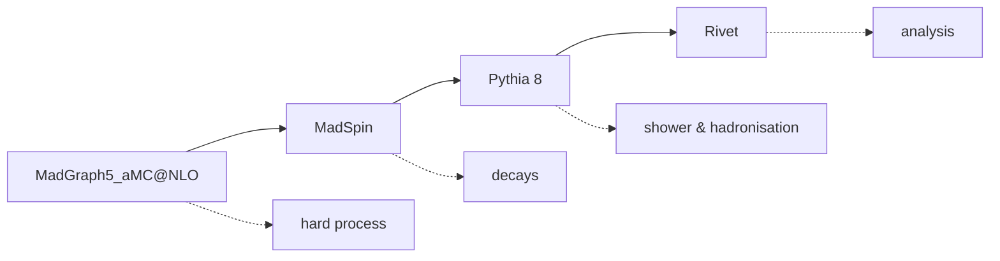

# mg-pipeline

`mg-pipeline` is a Python orchestration tool that runs a
**MadGraph5_aMC@NLO → MadSpin → Pythia 8 → Rivet** pipeline automatically,
driven by simple config cards.

## Contents

- [Overview](#overview)
- [Pipeline at a glance](#pipeline-at-a-glance)
- [Prerequisites](#prerequisites)
- [Usage](#usage)
  - [Running only some stages (recommended)](#running-only-some-stages-recommended)
  - [Resume mode](#resume-mode)
  - [Installation (optional)](#installation-optional)
- [Disclaimer, citing and license](#disclaimer-citing-and-license)

<!-- The --8<-- markers bracket sections that the documentation site includes
     (see mcgen-pipeline-docs). They are HTML comments: invisible on GitHub.
     Keep them if you edit this file, or the site build will miss content. -->

<!-- --8<-- [start:guide-head] -->
## Overview

It removes the manual bookkeeping of chaining the four tools together: each
stage's outputs are located and fed to the next stage for you, several cards
can be run in a single invocation, and runs are parallelised across available
cores and can be resumed.



## Pipeline at a glance

| Stage | Tool | Summary |
|-------|------|---------|
| `madgraph` | MadGraph5_aMC@NLO | Generates the hard process, produces LHE files |
| `madspin` | MadSpin | Decays intermediate resonances, produces decayed LHE files |
| `pythia` | Pythia 8 | Parton shower, hadronisation and decays, produces HepMC files |
| `rivet` | Rivet | Runs the analysis over HepMC files, produces YODA histograms |

## Prerequisites
<!-- --8<-- [end:guide-head] -->

<!-- --8<-- [start:prerequisites] -->
No additional Python packages are required to run this script. It has been
developed on Python 3.13 but should run with previous versions (>3.10).

To run this script you need a usable **MadGraph5_aMC@NLO** installation with
**MadSpin**, **Pythia 8** and **Rivet** properly configured. The script should
be run from the same directory as the root directories of the above programs:

```
ProjectRoot/
├── MG5_aMC_vX_Y_Z/   # MadGraph5_aMC@NLO root directory
├── pythiaXYZW/       # Pythia8 root directory
├── Rivet-X.X.X/      # Rivet root directory
├── madgraph_scripts/ # MadGraph scripts directory
├── madspin_scripts/  # MadSpin scripts directory
├── analysis/         # Analysis directory
└── mg_pipeline/run_script.py
```

The script can work without providing the exact versions of the above programs
and will automatically detect them at runtime. You can specify your own
directories using flags — see [Usage](#usage).

> **Note:** An example of the cards that can be used with this script can be
> found under the `example_cards` directory in this repository. Essentially they
> are simple txt files that are readily used by MadGraph/MadSpin anyway. You can
> have multiple different cards that can be executed in a single run.
<!-- --8<-- [end:prerequisites] -->

<!-- --8<-- [start:guide-tail] -->
## Usage

Run the pipeline script directly:

```bash
python run.py
```

Add the `--help` flag to see all available options:

```bash
python run.py --help
```

For example, to run in quiet mode:

```bash
python run.py -q
```

### Running only some stages (recommended)

You can run just a subset of the pipeline stages without having to interrupt
the run manually.

Valid stages are: `madgraph`, `madspin`, `pythia`, `rivet`.

Examples:

```bash
# Run only MadGraph + MadSpin and stop
python run.py --stages madgraph,madspin

# Run only Rivet (typically with --resume and an existing experiment directory)
python run.py --resume --intermediate-dir /path/to/Experiments_23 --stages rivet
```

### Resume mode

Resume mode is explicit:

- Without `--resume`, a new experiment folder is created (e.g. `Experiments`,
  `Experiments_2`, ...).
- With `--resume`, `--intermediate-dir` must point to an existing experiment
  directory and will be re-used.

### Installation (optional)

Since this is a proper Python project, you can also install it in editable mode:

```bash
pip install -e .
```

## Disclaimer, citing and license

### Disclaimer

`mg-pipeline` is an independent wrapper/orchestration tool. It is **not** part
of, affiliated with, endorsed by, or supported by the developers of the software
it drives. In particular, this project wraps:

- [MadGraph5_aMC@NLO](https://launchpad.net/mg5amcnlo) — event generation
  (MadSpin is distributed as part of it; see
  [arXiv:1307.1694](https://arxiv.org/abs/1307.1694))
- [PYTHIA](https://pythia.org/) — parton shower, hadronization and decays
- [Rivet](https://rivet.hepforge.org/) — analyses and histogramming

This tool only automates running the above programs with your cards; it does not
modify, redistribute or replace them. Please install them from their official
sources, respect their licenses, and report problems with the tools themselves
to their own bug trackers. Issues with the wrapper belong in this repository.

### Citing

If you use this tool in academic work, please cite the underlying tools as
requested by their authors (see links above).

### License

GNU GPL v3.0 or later — see [LICENSE](LICENSE).
<!-- --8<-- [end:guide-tail] -->
