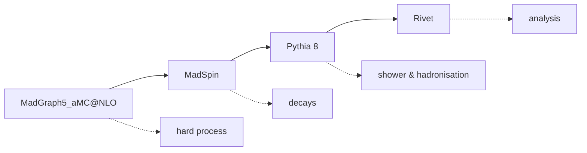

# mg-pipeline

`mg-pipeline` is a Python orchestration tool that runs a
**MadGraph5_aMC@NLO → MadSpin → Pythia 8 → Rivet** pipeline automatically,
driven by simple config cards.

It removes the manual bookkeeping of chaining the four tools together: each
stage's outputs are located and fed to the next stage for you, several cards
can be run in a single invocation, and runs are parallelised across available
cores and can be resumed.

## Pipeline at a glance

| Stage | Tool | Summary |
|-------|------|---------|
| `madgraph` | MadGraph5_aMC@NLO | Generates the hard process, produces LHE files |
| `madspin` | MadSpin | Decays intermediate resonances, produces decayed LHE files |
| `pythia` | Pythia 8 | Parton shower, hadronisation and decays, produces HepMC files |
| `rivet` | Rivet | Runs the analysis over HepMC files, produces YODA histograms |

## Where to next

- [Prerequisites](prerequisites.md) — what you need installed, and the expected layout
- [Usage](usage.md) — running the pipeline, subsets of stages, and resume mode
- [Disclaimer, citing and license](disclaimer.md)
